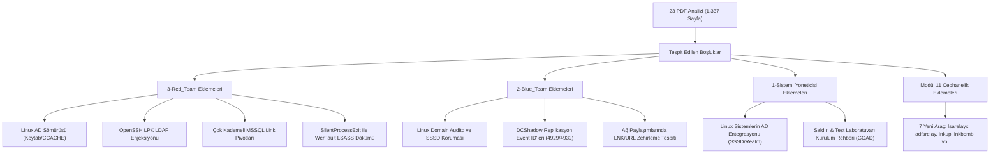

# Active Directory PDF Koleksiyonu Kapsamlı Analiz ve Boşluk Denetim Raporu

> **Analiz Edilen Dizin:** `/home/zeus/Desktop/Cybersecurity/active-directory-pdf`  
> **Toplam İncelenen Doküman:** 23 PDF Dosyası · **Toplam Sayfa:** 1.337 Sayfa · **Çıkarılan Metin Hacmi:** ~177.600 Kelime  
> **Tarih:** 2 Kasım 2026  
> **Hedef Modüller:** [1-Sistem_Yoneticisi](file:///home/zeus/Desktop/projeler/Active-Directory/1-Sistem_Yoneticisi) · [2-Blue_Team](file:///home/zeus/Desktop/projeler/Active-Directory/2-Blue_Team) · [3-Red_Team](file:///home/zeus/Desktop/projeler/Active-Directory/3-Red_Team)

---

## 1. Yönetici Özeti ve Analiz Metodolojisi

Kullanıcı tarafından sağlanan `/home/zeus/Desktop/Cybersecurity/active-directory-pdf` dizinindeki 23 adet PDF belgesi, sektörün en saygın sertifikasyon programları (Offensive Security OSCP, Altered Security CRTP/CRTE), güvenlik araştırma şirketleri (HADESS, Orange Cyberdefense, SpecterOps) ve bağımsız kırmızı takım araştırmacılarının operasyonel notlarından oluşmaktadır.

Tüm PDF dosyaları C++ tabanlı `pdftotext` motoru ve görsel tabanlı sayfalar için multimodal OCR yetenekleri kullanılarak metne dökülmüş, 177.676 kelimelik içerik taranmış; araçlar, saldırı vektörleri, savunma telemetrileri (Event ID, Sigma, Sysmon) ve laboratuvar kurulum mimarileri mevcut projemizdeki **316 markdown dokümanı** ile çapraz eşleştirmeye tabi tutulmuştur.

### Temel Çıkarım:
Projemiz (`Active-Directory`), mevcut yapısıyla Kerberos, NTLM relay, AD CS (ESC1-ESC13), DACL manipülasyonu ve modern EDR atlatma konularında son derece ileri düzey ve günceldir. Ancak PDF arşivinin derinlemesine incelenmesi sonucunda projemizde **3 kritik ana eksiklik kümesi** tespit edilmiştir:
1. **Linux Domain-Joined Sistemler:** Linux sunucuların AD'ye entegrasyonu (SSSD/realmd), Kerberos keytab (`/etc/krb5.keytab`), CCACHE biletlerinin `/tmp` veya keyring üzerinden çalınması ve OpenSSH LDAP şema suiistimalleri ne Red ne Blue ne de Sistem Yöneticisi tarafında derinlemesine yer almamaktadır.
2. **Çok Kademeli MSSQL Trust Pivotları:** Altered Security CRTP Lab kılavuzunda yer alan, ormanlar arası güven ilişkilerini (Forest Trusts) aşmak için kullanılan zincirleme MSSQL `OPENQUERY` ve `xp_cmdshell` rotaları eksiktir.
3. **Özel Gizli Kalıcılık ve Relay Yöntemleri:** `lsarelayx` (LSA paket seviyesinde genel sistem NTLM relay), `SilentProcessExit` ile WerFault üzerinden iz bırakmadan LSASS dökümü ve DA yetkisi olmadan `Set-PSSessionConfiguration` ile DC üzerinde kalıcılık sağlama teknikleri cephaneliğe dahil edilmelidir.

---

## 2. 23 PDF Belgesinin Eksiksiz Analiz ve Envanter Tablosu

Aşağıdaki tablo, incelenen 23 dosyanın her birinin sayfa sayısını, ana temasını, içerdiği kritik araçları ve projemizdeki karşılığını detaylandırmaktadır:

| # | PDF Dosya Adı | Sayfa | Temel Kapsam ve Kaynak | Öne Çıkan Araçlar / Vektörler | Projedeki Durum & Değerlendirme |
|---|---|---|---|---|---|
| **1** | `Active_Directory_Hacking_Techniques.pdf` | 174 | Kapsamlı AD Sızma Kitabı (Ralf Hacker / Rusça çeviri) | Mimikatz, Rubeus, PowerView, BBKUDC, AngryPuppy, LAPS, AppLocker | **Kısmen Mevcut.** Temel konular var; ancak LAPS bypass ve AppLocker kural atlatma detayları zenginleştirilebilir. |
| **2** | `AD_Exploitation_CheatSheet_Commands.pdf` | 31 | Windows & AD İstismar Komut Referansı (Security Ramblings) | PowerView, Rubeus, Mimikatz, Chisel, Plink, Impacket | **Mevcut.** Komutların %95'i [Modul 11](file:///home/zeus/Desktop/projeler/Active-Directory/3-Red_Team/Modul_11_Arac_Ustaligi_ve_Komut_Notlari) ve cephaneliğimizde yer alıyor. |
| **3** | `AD_Pentest_Active_Directory_Overview_and_Structure.pdf` | 124 | AD Mimarisi, Objeler, Replikasyon ve Yapı Slaytları | ntdsutil, dsa.msc, ldp.exe | **Mevcut.** [1-Sistem_Yoneticisi/Modul_01](file:///home/zeus/Desktop/projeler/Active-Directory/1-Sistem_Yoneticisi/Modul_01_Mimari_ve_Temeller) dokümanlarımız bu slaytlardan çok daha kapsamlıdır. |
| **4** | `AD_PENTEST_BloodHound_Enumeration_Guide.pdf` | 28 | HackingArticles BloodHound & SharpHound Kılavuzu | SharpHound, BloodHound GUI, Empire | **Mevcut.** [01.2_SharpHound_ve_BloodHound.md](file:///home/zeus/Desktop/projeler/Active-Directory/3-Red_Team/Modul_01_Kesif_ve_Numaralandirma/01.2_SharpHound_ve_BloodHound.md) dosyamız modern BloodHound CE ve Docker mimarisini zaten içermektedir. |
| **5** | `AD_PENTEST_GOAD_Attack_Techniques_Guide.pdf` | 82 | Orange Cyberdefense GOAD Lab Saldırı Senaryoları | NetExec, Impacket, Certipy, Coercer, Responder, BloodHound | **Kritik Eksik:** GOAD lab topolojisi (5 makine, multi-domain, MSSQL, AD CS) projemizde bir "Lab Kurulum Rehberi" olarak bulunmamaktadır. |
| **6** | `AD_Pentesting_Techniques_and_Exploits.pdf` | 45 | GitBook AD Pentest & Linux AD İstismarı | PowerView, Mimikatz, DiskShadow, CCACHE, Keytab, kinit | **Kritik Eksik:** Linux Active Directory (CCACHE ticket reuse, keytab extraction, /tmp biletleri) bölümü projemizde eksiktir. |
| **7** | `AD_Pentest_KaliLinux_Attacks.pdf` | 28 | Kali Linux üzerinden AD Saldırıları (Seang Y Phuon - CRTO/CRTE) | CrackMapExec, Evil-WinRM, Kerbrute, BloodHound, Impacket | **Mevcut.** Linux tabanlı saldırı araçlarımız Modül 11'de eksiksizdir. |
| **8** | `AD_PENTEST_Kerberoasting_Attack_Techniques.pdf` | 4 | Kerberoasting Derinlemesine Teknik İnceleme | Rubeus, PowerView, Hashcat, Impacket | **Mevcut.** [03.1_Kerberoasting_ve_AS_REP_Roasting.md](file:///home/zeus/Desktop/projeler/Active-Directory/3-Red_Team/Modul_03_Kimlik_Bilgisi_Erisimi/03.1_Kerberoasting_ve_AS_REP_Roasting.md) fazlasıyla kapsamaktadır. |
| **9** | `AD_PENTEST_Kerbrute_Guide.pdf` | 13 | HackingArticles Kerbrute Kullanım Kılavuzu | Kerbrute, Evil-WinRM | **Mevcut.** [02.3_Kerbrute_ile_Enum_ve_Spray.md](file:///home/zeus/Desktop/projeler/Active-Directory/3-Red_Team/Modul_02_Ilk_Erisim_ve_Yerlesme/02.3_Kerbrute_ile_Enum_ve_Spray.md) ve cephanelikte tam detaylıdır. |
| **10** | `AD_PENTEST_LabManual_Attack_Defense.pdf` | 122 | Altered Security CRTP Resmi Lab Kılavuzu (Nikhil Mittal) | PowerView, ADModule, SafetyKatz, Rubeus, Kekeo, Mimikatz | **Kritik Eksikler Var:** LO 10 (Diamond Ticket detayları), LO 13 (Set-PSSessionConfiguration kalıcılığı), LO 22 (MSSQL Database Links pivot) eksiktir. |
| **11** | `AD_PENTEST_Network_Scanning_and_Shell_Techniques.pdf` | 2 | Ağ Tarama ve Shell Komutları Hızlı Referans | Nmap, Netcat, PowerShell | **Mevcut.** Temel ağ komutları cephanelikte bulunmaktadır. |
| **12** | `AD_PENTEST_NTLM_Abuse_Methods.pdf` | 22 | HADESS NTLM Kötüye Kullanım Yöntemleri ve Araçları | LdapRelayScan, lsarelayx, Coercer, DragonCastle, LNKUp, Lnkbomb | **Kritik Eksik:** `lsarelayx`, `ADFSRelay`, `DragonCastle` (AutodialDLL), `LNKUp` araçları cephanelikte ve modüllerde yer almamaktadır. |
| **13** | `AD_Pentest_Offensive_ActiveDirectory_101.pdf` | 84 | Offensive AD 101 Eğitimi (Michael Ritter) | PowerView, BloodHound, CME, Mimikatz, Impacket | **Mevcut.** Temel saldırı patikaları ve anlatım projemizde detaylıca yer almaktadır. |
| **14** | `AD_Pentest_Offensive_Attributes_Exploitation.pdf` | 15 | HADESS Active Directory Nitelik İstismarı | PowerView, ADModule, Cypher Queries, LDAP Attributes | **Eksik Nitelikler:** `supplementalCredentials`, `primaryGroupID`, `userWorkstations`, `logonHours` nitelik sömürüleri zenginleştirilmelidir. |
| **15** | `AD_PENTEST_PassTheHash_Attack_Techniques.pdf` | 29 | HackingArticles PtH Teknikleri ve Araçları | Mimikatz, Impacket, CME, WCE | **Mevcut.** [04.1_Pass_the_Hash_ve_Overpass_the_Hash.md](file:///home/zeus/Desktop/projeler/Active-Directory/3-Red_Team/Modul_04_Yanal_Hareket/04.1_Pass_the_Hash_ve_Overpass_the_Hash.md) çok daha günceldir. |
| **16** | `AD_PENTEST_Privilege_Escalation_40_Methods.pdf` | 186 | HADESS 40+ Yetki Yükseltme Metodu (Part 1, 2, 3) | SSSD, OpenSSH LPK, SilentProcessExit, Shtinkering, UsoDllLoader | **Kritik Eksik:** Linux domain PrivEsc (OpenSSH LPK, SSSD), WerFault / SilentProcessExit LSASS dökümü projemizde yer almamaktadır. |
| **17** | `AD_PENTEST_Vulnerable_Domain_Setup_Guide.pdf` | 52 | Savunmasız AD Test Ortamı Tasarımı ve Kurulumu | Samba, SSSD, Linux Domain Join, BloodHound | **Kritik Eksik:** Sistem Yöneticisi modülünde Linux makinelerin AD ortamına dahil edilmesi ve zafiyetli lab tasarımı eksiktir. |
| **18** | `AD_Security_Handbook_Penetration_Testing.pdf` | 53 | Tam AD Güvenlik El Kitabı (Saldırı, Tespit, Azaltma) | Event ID 4624, 4672, 4768, 4769, DCShadow, AD CS Relay | **Önemli Katkı:** DCShadow replikasyon Event ID'leri (4929, 4932, 4933) ve PetitPotam AD CS relay telemetrisi Blue Team'e entegre edilmelidir. |
| **19** | `AG_SIZMA_Active_Directory_Exploitation_Cheatsheet.pdf` | 78 | BlackWasp Kapsamlı AD İstismar Notları | BloodHound, Certipy, Whisker, PetitPotam, ShadowCoerce, DFSCoerce | **Mevcut.** [Modul 08](file:///home/zeus/Desktop/projeler/Active-Directory/3-Red_Team/Modul_08_Koersiyon_ve_NTLM_Relay) ve [Modul 07](file:///home/zeus/Desktop/projeler/Active-Directory/3-Red_Team/Modul_07_AD_CS_PKI_Saldirilari) bu içeriği fazlasıyla karşılamaktadır. |
| **20** | `CERT_DIGER_Active_Directory_Attack_Techniques.pdf` | 38 | CRTP Keşif ve Saldırı Notları | PowerView komutları, ACL filtreleri | **Mevcut.** [Modul 01](file:///home/zeus/Desktop/projeler/Active-Directory/3-Red_Team/Modul_01_Kesif_ve_Numaralandirma) PowerView bölümümüz daha detaylıdır. |
| **21** | `CERT_DIGER_Active_Directory_Beginners_Guide.pdf` | 36 | Başlangıç Seviyesi AD Rehberi (Dale Hobbs) | AD Temelleri, Kerberos Akışı, Event ID'ler | **Mevcut.** Mimari ve temel teorik konularımız çok daha zengindir. |
| **22** | `CERT_DIGER_Attacking_Active_Directory_with_Linux.pdf` | 20 | Linux Üzerinden AD Saldırıları (Hernan Rodriguez) | Bloodhound-python, Impacket, Responder, Mitm6, DnsAdmin | **Mevcut.** DnsAdmin ve Linux araçları cephaneliğimizde yer almaktadır. |
| **23** | `OSCP_Active_Directory_Notes.pdf` | 71 | OSCP Active Directory Notları (PEN-200) | PowerView, Mimikatz, Rubeus, Chisel, PrintNightmare, ZeroLogon | **Mevcut.** [3-Red_Team/PLAYBOOK.md](file:///home/zeus/Desktop/projeler/Active-Directory/3-Red_Team/PLAYBOOK.md) dosyamız bu akışı aşama aşama vermektedir. |

---

## 3. Red Team (`3-Red_Team`) Tarafındaki Eksiklikler ve Geliştirme Alanları

PDF arşivinden çıkarılan ve projemizin Kırmızı Takım bölümünde yer almayan veya yüzeysel kalan operasyonel teknikler şunlardır:

### 3.1. Linux Domain-Joined Sistem İstismarı (SSSD, Keytab, CCACHE)
*Kaynak Dokümanlar:* `AD_Pentesting_Techniques_and_Exploits.pdf`, `AD_PENTEST_Privilege_Escalation_40_Methods.pdf`, `AD_PENTEST_Vulnerable_Domain_Setup_Guide.pdf`
- **Mevcut Durum:** Projemizde Linux üzerinden Windows hedeflere saldırmak (Kali Linux araçları) çok iyi anlatılmıştır; ancak **Active Directory etki alanına dahil edilmiş bir Linux sunucunun (SSSD/Realmd)** kendi içindeki bilet ve anahtar varlıklarının nasıl sömürüleceği eksiktir.
- **Eksik Teknikler:**
  1. `/etc/krb5.keytab` dosyasının okunarak makine veya servis hesabı parolalarının/biletlerinin `klist -k -t /etc/krb5.keytab` ve `kinit -k -t /etc/krb5.keytab <SPN>` ile Kerberos TGT'sine dönüştürülmesi.
  2. `/tmp/krb5cc_*` dosyalarından aktif kullanıcı Kerberos biletlerinin (CCACHE) çalınması (`export KRB5CCNAME=/tmp/krb5cc_...`).
  3. Linux Kernel Keyring (`keyctl show`, `keyctl pipe`) ve SSSD KCM (`/var/lib/sss/secrets/`) önbelleklerinden bilet çıkarma.
  4. Çalınan Linux CCACHE biletlerinin Impacket uyumlu biletlere veya Windows `.kirbi` formatına dönüştürülmesi (`ticketConverter.py`).

### 3.2. OpenSSH LPK Şema Manipülasyonu (LDAP `sshPublicKey` Enjeksiyonu)
*Kaynak Doküman:* `AD_PENTEST_Privilege_Escalation_40_Methods.pdf` (Sayfa 13)
- **Mevcut Durum:** Projemizde Windows DACL istismarı (GenericAll, WriteDacl) detaylıdır; fakat Linux LDAP entegrasyonu sağlayan şema eklentilerinin istismarı yoktur.
- **Eksik Teknik:** Kurumsal ortamlarda Linux sunucular OpenSSH LPK (`ldapPublicKey` objectClass) ile kullanıcıların SSH public anahtarlarını Active Directory LDAP üzerinden doğrular. Saldırgan hedef kullanıcının LDAP nesnesinde `GenericWrite` veya `WriteProperty` yetkisine sahip olduğunda, kullanıcının `sshPublicKey` özniteliğine kendi public key'ini enjekte ederek parolasız root/admin SSH oturumu elde edebilir.

### 3.3. Ormanlar Arası Çok Kademeli MSSQL Database Link İstismarı
*Kaynak Doküman:* `AD_PENTEST_LabManual_Attack_Defense.pdf` (Learning Objective 22)
- **Mevcut Durum:** Projemizde yerel SQL Server sömürüsü ve `xp_cmdshell` bulunmaktadır; ancak güven sınırlarını (Trust boundaries) aşmak için kullanılan zincirleme database linkleri eksiktir.
- **Eksik Teknik:** `dcorp-mssql` -> `eurocorp-sql1` -> `eurocorp-sql2` şeklinde çift yönlü trust veya one-way trust üzerinden linked server ilişkilerinin `OPENQUERY` veya `EXEC ('...') AT [LINKED_SERVER]` ile sorgulanması, sysadmin ayrıcalıklarına ulaşılarak etki alanları arası pivot yapılması.

### 3.4. LSA Düzeyinde Sistem Çapında NTLM Relay (`lsarelayx`)
*Kaynak Doküman:* `AD_PENTEST_NTLM_Abuse_Methods.pdf` (Sayfa 14)
- **Mevcut Durum:** Projemizde `ntlmrelayx` ve SMB/HTTP relay mevcuttur; ancak sistem düzeyinde çalışan sahte LSA Authentication Provider kancalaması yer almamaktadır.
- **Eksik Teknik:** `lsarelayx.exe` ve `liblsarelayx.dll` kullanılarak LSASS içine özel bir LSA sağlayıcısı yüklenir. Bu sağlayıcı, sistemdeki tüm Kerberos isteklerini zorla NTLM'e düşürür (fallback), makineye gelen SMB/HTTP/RPC tüm kimlik doğrulamalarını yerel adlandırılmış boru (named pipe) üzerinden yakalayarak `ntlmrelayx RAW server` modülüne aktarır.

### 3.5. İleri Seviye Gizli LSASS Bellek Dökümü (`SilentProcessExit` ve `WerFault`)
*Kaynak Doküman:* `AD_PENTEST_Privilege_Escalation_40_Methods.pdf` (Sayfa 134-136)
- **Mevcut Durum:** Projemizde `procdump`, `comsvcs.dll`, `mimikatz` ve `nanodump` vardır.
- **Eksik Teknik:** EDR sistemleri doğrudan LSASS sürecine `PROCESS_VM_READ` bayrağı ile açılan kolları (handles) sıkı takip eder. Windows Hata Bildirimi (WER) mekanizması olan `SilentProcessExit` kayıt defteri anahtarı (`HKLM\SOFTWARE\Microsoft\Windows NT\CurrentVersion\SilentProcessExit\lsass.exe`) yapılandırılarak, LSASS süreci sonlandırılmadan WerFault.exe üzerinden yasal bir kilitlenme dökümü (`WerFault.exe -u -p <LSASS_PID>`) üretilmesi ve EDR alarmlarının atlatılması.

### 3.6. DA Yetkisi Olmadan Düşük Ayrıcalıklı DC Kalıcılığı (CRTP LO 13)
*Kaynak Doküman:* `AD_PENTEST_LabManual_Attack_Defense.pdf` (Learning Objective 13)
- **Mevcut Durum:** Kalıcılık modülümüzde AdminSDHolder, Skeleton Key, DSRM ve Golden Ticket gibi yüksek gürültülü DA kalıcılıkları vardır.
- **Eksik Teknik:** Etki Alanı Yöneticisi yetkisi alındıktan sonra standart bir kullanıcıya DC üzerinde `Set-PSSessionConfiguration -Name Microsoft.PowerShell` ile PowerShell Remoting ve `Set-WmiNamespaceSecurity -Namespace root/cimv2` ile WMI yürütme yetkisi tanımlanarak, kullanıcı AdminSDHolder veya Domain Admins grubuna dahil edilmeden arka planda görünmez bir uzaktan yönetim kalıcılığı elde edilmesi.

### 3.7. Cephaneliğe (Modül 11) Eklenebilecek Yeni Araçlar
Aşağıdaki araçlar PDF'lerde operasyonel olarak yer alıp [Modul 11](file:///home/zeus/Desktop/projeler/Active-Directory/3-Red_Team/Modul_11_Arac_Ustaligi_ve_Komut_Notlari) cephaneliğimize eklendiğinde kataloğumuz 146 araçtan ~153 araca çıkacaktır:
1. **`lsarelayx`** (Kategori 05 — NTLM ve Kerberos Relay Motorları)
2. **`ADFSRelay`** (Kategori 14 — AD FS, Bulut ve Hibrit Kimlik)
3. **`LNKUp`** (Kategori 04 — Zehirleme, MitM ve Zorlamalı Kimlik)
4. **`Lnkbomb`** (Kategori 10 — Kurumsal Altyapı Paylaşım ve Veri Avı)
5. **`DragonCastle`** (Kategori 07 — Bellek Analizi, LSASS ve DPAPI Hasadı)
6. **`LdapRelayScan`** (Kategori 05 — NTLM ve Kerberos Relay Motorları)
7. **`ticketConverter`** (Kategori 06 — Kerberos Protokol Cephaneliği — ccache ↔ kirbi)

---

## 4. Blue Team (`2-Blue_Team`) Tarafındaki Eksiklikler ve Geliştirme Alanları

PDF arşivindeki tespit, telemetri ve azaltma (mitigation) bölümleri incelendiğinde Mavi Takım tarafındaki boşluklar şunlardır:

### 4.1. Linux Domain-Joined Sistemler İçin Güvenlik ve Telemetri Standartları
*Kaynak Doküman:* `AD_Pentesting_Techniques_and_Exploits.pdf` & `AD_PENTEST_Privilege_Escalation_40_Methods.pdf`
- **Eksik Bölüm:** [2-Blue_Team/Modul_03_Kimlik_Bilgisi_Korumasi](file:///home/zeus/Desktop/projeler/Active-Directory/2-Blue_Team/Modul_03_Kimlik_Bilgisi_Korumasi) ve [Modul_01](file:///home/zeus/Desktop/projeler/Active-Directory/2-Blue_Team/Modul_01_Gorunurluk_ve_Log_Yonetimi) tamamen Windows telemetrisine odaklanmıştır.
- **Eklenecek Hususlar:**
  - `/etc/krb5.keytab` dosya izinlerinin sıkılaştırılması (`chmod 600`, sadece root okuma).
  - Linux `auditd` kuralları ile keytab ve `/tmp/krb5cc_*` dosyalarına erişimlerin loglanması:
    ```bash
    -w /etc/krb5.keytab -p rwa -k keytab_access
    -w /tmp/ -p rwa -k krb5_ccache_access
    ```
  - SSSD yapılandırmasında `krb5_ccache_type = KCM` kullanılarak biletlerin diskteki `/tmp` dizini yerine çekirdek/bellek tabanlı KCM içinde tutulması ve şifrelenmesi.

### 4.2. DCShadow Saldırısının Derin Telemetri ve Olay Günlükleri
*Kaynak Doküman:* `AD_Security_Handbook_Penetration_Testing.pdf` (Sayfa 28-31)
- **Eksik Bölüm:** [02.1_Kritik_Event_ID_Katalogu.md](file:///home/zeus/Desktop/projeler/Active-Directory/2-Blue_Team/Modul_02_SIEM_ve_Tespit_Muhendisligi/02.1_Kritik_Event_ID_Katalogu.md) dosyasında DCShadow sadece özet geçilmiştir; spesifik replikasyon logları eksiktir.
- **Eklenecek Event ID'ler:**
  - **Event ID 4742:** Bilgisayar nesnesinde `GC/` (Global Catalog) veya `E3514235-4B06-11D1-AB04-00C04FC2DCD2/` (Directory Service Agent) SPN'lerinin kaydedilmesi.
  - **Event ID 4929 / 4932 / 4933:** Etki alanı dışındaki veya yetkisiz bir istemci IP adresinden gelen `Directory Service Replication` çağrıları ve replikasyon bağlamı değişiklikleri.
  - **Ağ İmzası:** RPC `DRSAddEntry` ve `DRSReplicaAdd` fonksiyon çağrılarının gerçek bir DC IP'si haricindeki bir iş istasyonundan gelmesi.

### 4.3. Dosya Paylaşımlarında Zararlı Kısayol (`.lnk` / `.url` / `.scf`) Tespiti
*Kaynak Doküman:* `AD_PENTEST_NTLM_Abuse_Methods.pdf` & `AD_Pentesting_Techniques_and_Exploits.pdf`
- **Eksik Bölüm:** Paylaşım zehirleme saldırılarına karşı SIEM/EDR kuralları eksiktir.
- **Eklenecek Tespitler:**
  - **Sysmon Event ID 11 (FileCreate):** Ağ paylaşımlarında (`\\*\*\*.lnk` veya `\\*\*\*.url`) yaratılan ve içeriğinde `iconfile=\\\\` UNC yolu barındıran dosyaların tespiti.
  - **Windows Security Event ID 5145:** Ağ paylaşımına yüklenen `.url`, `.lnk`, `.scf` uzantılı dosya yazma aktiviteleri.

### 4.4. Sahte LSA Sağlayıcı ve AutodialDLL Tespiti
*Kaynak Doküman:* `AD_PENTEST_NTLM_Abuse_Methods.pdf` (lsarelayx ve DragonCastle)
- **Eksik Bölüm:** LSASS içine sahte güvenlik paketi yükleme tespiti.
- **Eklenecek Tespitler:**
  - **Sysmon Event ID 7 (ImageLoaded):** `lsass.exe` sürecine imzasız veya bilinmeyen bir DLL dosyasının yüklenmesi.
  - **Kayıt Defteri İzleme (Sysmon Event ID 13):** `HKLM\SYSTEM\CurrentControlSet\Control\Lsa\Security Packages` ve `HKLM\System\CurrentControlSet\Services\RasMan\Parameters\AutodialDLL` anahtarlarına yapılan yetkisiz yazma işlemleri.

---

## 5. Sistem Yöneticisi (`1-Sistem_Yoneticisi`) Tarafındaki Eksiklikler ve Mimari Eklemeler

Sistem Yöneticisi modülü kurumsal AD DS yönetimi açısından çok sağlamdır, ancak modern heterojen (hibrit/Linux) altyapılar ve güvenlik test laboratuvarları açısından şu 3 ana eksiklik bulunmaktadır:

### 5.1. Linux İstemci ve Sunucuların Active Directory Entegrasyonu
*Kaynak Dokümanlar:* `AD_PENTEST_Vulnerable_Domain_Setup_Guide.pdf`, `CERT_DIGER_Attacking_Active_Directory_with_Linux.pdf`
- **Mevcut Durum:** [1-Sistem_Yoneticisi](file:///home/zeus/Desktop/projeler/Active-Directory/1-Sistem_Yoneticisi) dizinindeki 10 modülün tamamı Windows Server ve Windows istemci odaklıdır.
- **Eklenebilecek Konu:** Modern işletmelerde web, veritabanı ve konteyner altyapılarının %80'i Linux üzerinde koşmaktadır ve hepsi AD'ye entegredir.
- **Detay:**
  - `realmd` ve `sssd` kurulumu, etki alanına dahil etme (`realm join -U Administrator domain.com`).
  - `/etc/sssd/sssd.conf` güvenli yapılandırma şablonu (Kerberos şifreleme, FAST armoring).
  - Sudo yetkilerinin AD Güvenlik Gruplarına (`sudoers.d`) devredilmesi.
  - Sertifika tabanlı SSH oturum açma ve LDAP şema güvenliği.

### 5.2. Kurumsal Güvenlik Test ve Simülasyon Laboratuvarı Kurulum Rehberi
*Kaynak Dokümanlar:* `AD_PENTEST_GOAD_Attack_Techniques_Guide.pdf` & `AD_PENTEST_Vulnerable_Domain_Setup_Guide.pdf`
- **Mevcut Durum:** Sistem Yöneticisi modülünde üretim ortamı mimarisi anlatılmıştır ancak bir yöneticinin veya mavi/kırmızı takım operatörünün güvenli bir şekilde saldırı-savunma testleri yapabileceği **laboratuvar kurulum şablonu** bulunmamaktadır.
- **Eklenebilecek Konu:**
  - **GOAD (Game of Active Directory):** Vagrant ve Ansible ile 5 sanal makineli çoklu etki alanı (Parent-Child, Forest Trust, AD CS, MSSQL) otomatik dağıtım rehberi.
  - **Vulnerable-AD-Plus:** Tek PowerShell komutuyla Active Directory üzerinde kontrollü zafiyetlerin (DACL zafiyetleri, Kerberoasting SPN'leri, zayıf parolalar, unconstrained delegation) oluşturulması ve temizlenmesi.

### 5.3. MSSQL Hizmet Hesabı ve Database Link Güvenlik Standardı
*Kaynak Doküman:* `AD_PENTEST_LabManual_Attack_Defense.pdf` (LO 22) & `AD_PENTEST_Privilege_Escalation_40_Methods.pdf` (Method 8)
- **Eksik Konu:** Kurumsal SQL Server servislerinin Active Directory gMSA hesaplarıyla çalıştırılması ve ormanlar arası `sp_addlinkedserver` bağlantılarında `rpc out` ve `impersonation` güvenlik politikalarının yapılandırılması rehberi.

---

## 6. Hatalı, Eski veya Güncellenmesi Gereken Noktalar (Troubleshooting & Modernizasyon)

PDF belgelerinde yer alan bazı komut ve araçlar ile projemizdeki bazı referanslar modern Active Directory sürümleri (Windows Server 2022/2025, Windows 11 23H2+) açısından güncellik gerektirmektedir:

1. **CrackMapExec (CME) → NetExec (nxc) Geçişi:**
   - *PDF Durumu:* İncelenen PDF'lerin neredeyse tamamı (`GOAD`, `KaliLinux_Attacks`, `BlackWasp`, `Linux_Attacks`) artık geliştirilmesi durdurulan `crackmapexec` aracını kullanmaktadır.
   - *Bizim Durumumuz:* Projemizde [NetExec](file:///home/zeus/Desktop/projeler/Active-Directory/3-Red_Team/Modul_11_Arac_Ustaligi_ve_Komut_Notlari/Kategori_11_Yanal_Hareket_ve_Uzak_Kod_Yurutme/NetExec.md) doğru şekilde ana araç yapılmıştır. Ancak belgelerde CME komutları görüldüğünde operatörlere doğrudan `nxc` sözdizimini kullanmaları gerektiği uyarısı verilmelidir.
2. **BloodHound Legacy (Neo4j Desktop) → BloodHound CE (SpecterOps API):**
   - *PDF Durumu:* PDF'lerdeki (`BloodHound_Enumeration_Guide`, `OSCP_Notes`) anlatımlar BloodHound 3.x ve 4.x masaüstü istemcisine dayanmaktadır.
   - *Bizim Durumumuz:* Projemiz doğru şekilde BloodHound CE (Docker Compose tabanlı modern sürüm) üzerine kurgulanmıştır.
3. **PrintNightmare (CVE-2021-1675) ve ZeroLogon (CVE-2020-1472):**
   - *PDF Durumu:* PDF'lerde bu saldırılar genellikle "yama uygulanmamış DC'lere anında Domain Admin olma" şeklinde sunulmaktadır.
   - *Operasyonel Not:* Modern etki alanı denetleyicilerinde RPC Sealing ve zorunlu Netlogon Secure Channel zorunludur. Projemizde bu zafiyetlerin tarihi/lab bağlamında sunulması ve modern yamalı ortamlarda doğrudan çalışmayacağı belirtilmelidir.
4. **NTLM'in Devre Dışı Bırakılması Yol Haritası:**
   - Microsoft, Windows 11 ve Server 2025 ile birlikte yerel NTLM'i tamamen devre dışı bırakıp IAKRB ve Local KDC mimarisine geçmektedir. Projemizdeki protokol sertleştirme bölümlerine bu modern yol haritası bir "Gelecek Perspektifi" notu olarak eklenmelidir.

---

## 7. Somut Eylem Planı ve Entegrasyon Yol Haritası

Yukarıdaki bulgular ışığında, projemizi eksiksiz bir "Active Directory Ansiklopedisi ve Cephaneliği" haline getirmek için önerilen somut adımlar:



### 1. Öncelikli Adım: Red Team'e Yeni Konuların Eklenmesi
- [Modul_03_Kimlik_Bilgisi_Erisimi](file:///home/zeus/Desktop/projeler/Active-Directory/3-Red_Team/Modul_03_Kimlik_Bilgisi_Erisimi) altına veya Modül 04'e **`03.5_Linux_Active_Directory_Bilet_ve_Keytab_Hasadi.md`** dosyası eklenmelidir.
- [Modul_05_Yetki_Yukseltme_ACL_ve_GPO](file:///home/zeus/Desktop/projeler/Active-Directory/3-Red_Team/Modul_05_Yetki_Yukseltme_ACL_ve_GPO) altına **OpenSSH LPK LDAP Schema Sömürüsü** eklenmelidir.
- [Modul_04_Yanal_Hareket](file:///home/zeus/Desktop/projeler/Active-Directory/3-Red_Team/Modul_04_Yanal_Hareket) altına **Çok Kademeli MSSQL Linked Server Pivotu** detaylandırılmalıdır.

### 2. İkinci Adım: Modül 11 Araç Cephaneliğine 7 Yeni Aracın Yazılması
Zorunlu 6 bölümlük Modül 11 şablonumuza uygun olarak:
- `lsarelayx.md` (Kategori 05)
- `ADFSRelay.md` (Kategori 14)
- `LNKUp.md` (Kategori 04)
- `Lnkbomb.md` (Kategori 10)
- `DragonCastle.md` (Kategori 07)
- `LdapRelayScan.md` (Kategori 05)
- `ticketConverter.md` (Kategori 06)

### 3. Üçüncü Adım: Blue Team Telemetri Zenginleştirmesi
- [02.1_Kritik_Event_ID_Katalogu.md](file:///home/zeus/Desktop/projeler/Active-Directory/2-Blue_Team/Modul_02_SIEM_ve_Tespit_Muhendisligi/02.1_Kritik_Event_ID_Katalogu.md) içine DCShadow Event ID'leri (4929, 4932, 4933, 4742) ve AD CS NTLM Relay telemetrisi eklenmelidir.
- [Modul_03_Kimlik_Bilgisi_Korumasi](file:///home/zeus/Desktop/projeler/Active-Directory/2-Blue_Team/Modul_03_Kimlik_Bilgisi_Korumasi) içine Linux Domain-Joined makinelerin SSSD ve Keytab sertleştirme kılavuzu eklenmelidir.

### 4. Dördüncü Adım: Sistem Yöneticisi Laboratuvar Rehberi
- [1-Sistem_Yoneticisi](file:///home/zeus/Desktop/projeler/Active-Directory/1-Sistem_Yoneticisi) altına **`Modul_11_Lab_Kurulum_ve_Guvenlik_Test_Ortamlari`** veya Modül 10 içine GOAD / Vulnerable-AD tabanlı laboratuvar kurulum kılavuzu eklenmelidir.
